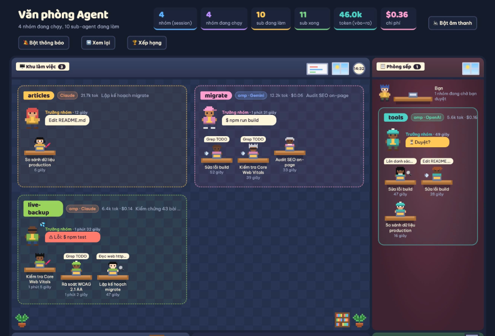
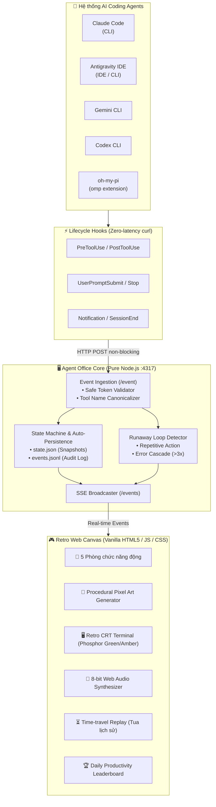

# 🏢 VĂN PHÒNG AGENT (AGENT OFFICE)

<p align="right">
  <b>🇻🇳 Tiếng Việt</b> | <a href="README_EN.md">🇺🇸 English</a>
</p>

> **Biến dòng lệnh AI khô khan thành một thế giới Pixel Art sống động thời gian thực!**  
> Trực quan hóa hoạt động của **Claude Code**, **Antigravity IDE**, **Gemini CLI**, **Codex CLI**, và **oh-my-pi (omp)** cùng dàn sub-agent trong một tòa nhà văn phòng retro 8-bit.

[-success?style=for-the-badge&logo=node.js&color=68a063)](https://nodejs.org/)
[](https://github.com/giangbh/agent-office)
[](https://developer.mozilla.org/en-US/docs/Web/API/Server-sent_events)
[](https://github.com/giangbh/agent-office)
[](https://github.com/giangbh/agent-office)
[](LICENSE)

---



---

## 🌟 Tại sao bạn cần "Văn phòng Agent"?

Khi làm việc với các Coding Agent hiện đại (đặc biệt khi chúng chia việc cho hàng loạt **Sub-agent**, chạy song song đa tiến trình), bạn thường đối mặt với một **chiếc hộp đen dòng lệnh**:
- ❓ *Agent đang làm gì? Đang đọc file, chạy bash hay đang bị treo?*
- ❓ *Có bao nhiêu sub-agent đang chạy ngầm dưới nền? Khi nào chúng làm xong?*
- 🚨 *Agent có bị **kẹt vòng lặp vô tận (Runaway Loop)** và đang âm thầm đốt cạn tiền token của bạn không?*
- ❓ *Khi nào agent cần bạn cấp quyền duyệt (Human-in-the-loop)?*

**Văn phòng Agent** giải quyết tất cả bằng **Game hóa trực quan (Visual Gamification)**:
Mỗi phiên làm việc là một **nhóm công tác**, mỗi sub-agent là một **nhân viên ngồi bàn gõ phím**, khi cần duyệt sẽ sang **Phòng sếp xếp hàng vẫy tay**, khi rảnh ra **Góc cà phê xả hơi**, khi gặp lỗi thì **toát mồ hôi hột**, và khi bị kẹt vòng lặp thì **còi báo động 8-bit đỏ rực hú vang**!

---

## ⚡ Bắt đầu nhanh trong 30 giây

### 1. Trải nghiệm ngay chế độ Demo (Không cần cài CLI nào)
```bash
node server.js --demo
```
👉 Mở trình duyệt tại **[http://localhost:4317](http://localhost:4317)** để xem các nhóm pixel art chạy thử lập tức!

---

### 2. Kết nối với Agent thật bằng 1-Click Hooks ⚡

Không cần sao chép JSON thủ công! Bạn có thể cài đặt hook tự động cho tất cả công cụ:

#### 🖱️ Cách 1: Bấm nút trên Web Dashboard (Tiện lợi nhất)
1. Khởi động server:
   ```bash
   node server.js
   ```
2. Truy cập **[http://localhost:4317](http://localhost:4317)** và bấm nút **`⚡ Hooks`** góc trên cùng bên phải.
3. Bấm **`⚡ Cài đặt tất cả 1-Click`** — hệ thống sẽ tự động tìm kiếm và kích hoạt hook cho tất cả công cụ có trên máy bạn!

#### 💻 Cách 2: Qua Terminal CLI (`setup-hooks.js`)
Zero-dependency, an toàn tuyệt đối với cơ chế tự sao lưu `.bak`:
```bash
# Xem trạng thái cài đặt hiện tại
node setup-hooks.js --status

# Cài đặt tự động 1-click cho tất cả
node setup-hooks.js

# Hoặc cài riêng cho từng công cụ bạn đang dùng:
node setup-hooks.js --claude        # Claude Code (~/.claude/settings.json)
node setup-hooks.js --antigravity   # Antigravity IDE (~/.gemini/config/hooks.json)
node setup-hooks.js --gemini        # Gemini CLI (~/.gemini/settings.json)
node setup-hooks.js --codex         # Codex CLI (~/.codex/hooks.json)

# Gỡ bỏ sạch sẽ bất kỳ lúc nào:
node setup-hooks.js --uninstall
```

> **🛡️ Cơ chế an toàn của Setup-hooks:**
> - Luôn tạo file sao lưu `<file>.bak-agent-office` trước khi sửa.
> - Chỉ thêm/gỡ đúng các lệnh của Agent Office (đánh dấu `# agent-office`), giữ nguyên 100% các hook cá nhân khác của bạn.
> - Chống CSRF/DNS Rebinding: Web API chỉ nhận lệnh từ chính `localhost`/`127.0.0.1`.

---

## 🏗️ Kiến trúc hệ thống thời gian thực

Toàn bộ hệ sinh thái hoạt động với triết lý **Zero-latency** và **Zero-overhead**:



---

## 🎯 10 Điểm sáng tính năng khiến bạn "Trầm trồ"

| Biểu tượng | Tính năng | Mô tả chi tiết |
|:---:|:---|:---|
| 🏢 | **5 Phòng Chức Năng Động** | Nhóm tự động di chuyển giữa các phòng theo trạng thái thực tế: **Khu làm việc** (đang chạy), **Phòng sếp** (chờ duyệt), **Phòng chờ việc** (rảnh), **Phòng ngủ gật** (mất tín hiệu), và **Góc cà phê** (sub-agent hoàn thành). |
| 🚨 | **Cảnh Báo Vòng Lặp Vô Tận** | Khi agent bị kẹt loop (gọi cùng 1 lệnh hoặc gặp lỗi liên tiếp 3 lần), pod lập tức nhấp nháy viền đỏ, giương cờ `🚨 VÒNG LẶP` và hú còi cảnh báo 8-bit để cứu ví token của bạn! |
| 🖥️ | **Retro CRT Terminal Inspector** | Bấm phím **`T`** để mở màn hình CRT cổ điển thập niên 80-90 (hiệu ứng bóng đèn hình cong và sọc scanline). Cho phép soi chi tiết câu lệnh, thời gian, trạng thái exit code và toàn bộ output stdout/stderr. Hỗ trợ đổi màu đèn Phosphor **Xanh lá (P1)** hoặc **Hổ phách (P3)**. |
| ⚡ | **Cài Đặt Hook 1-Click** | Drawer quản lý Hook trực tiếp trên giao diện web hoặc qua file script CLI `setup-hooks.js`. Hỗ trợ Claude Code, Antigravity IDE, Gemini CLI, Codex CLI với sao lưu an toàn. |
| 🎨 | **Pixel Art Đa Dạng & Độc Bản** | Nhân vật phong phú với **13 kiểu tóc/mũ** (mũ bảo hộ 👷, mũ phù thủy 🧙‍♂️, tóc xù afro, mũ lưỡi trai...), **9 kiểu mặt** (kính VR Cyberpunk 🥽, kính cận nerd 🤓, khẩu trang 😷, râu quai nón 🧔...), **9 kiểu áo** (áo Hawaii 🌺, vest 👔, hoodie, áo len...). Phụ kiện động theo vai trò: 🔍 `scout`, 🖍️ `reviewer`, 💨 `sonic`, 🔨 `builder`, 🪲 `debugger`, 📜 `writer`, 🛡️ `security`. |
| 🏷️ | **Logo Pixel Art Các Hãng AI** | Thay vì chữ text thô sơ, cờ nhóm tích hợp **Logo Pixel Art thu nhỏ chính thức** của từng hãng: Claude (ngôi sao Anthropic 8 cánh), Gemini (ngôi sao 4 cánh lam-tím), OpenAI (hoa thị xoắn ốc xanh ngọc), Antigravity (tam giác DeepMind tím), Codex, và omp. |
| 🛋️ | **Nội Thất & Đồ Đạc Sống Động** | Hàng loạt đồ vật pixel art: **Cây nước nóng lạnh**, **Tủ lạnh Pantry**, **Máy bán nước tự động**, **Tủ Server Rack** đèn LED xanh đỏ nhấp nháy, **Bảng trắng dự án**, **Thùng rác tái chế**, máy pha cà phê, sofa và cây cảnh. |
| 🎵 | **Bộ Tổng Hợp Âm Thanh 8-Bit** | Tích hợp Web Audio API thuần (không cần file mp3 nặng nề): tiếng *ting* nhặt xu 8-bit khi sub-agent làm xong, hai nốt trầm khi chờ sếp duyệt, tiếng bíp khi nhận việc, và còi báo động khẩn cấp. |
| ⏳ | **Hộp Đen Tua Ngược Thời Gian** | Nút **⏪ Xem lại** cho phép bạn tua ngược thời gian từ vài phút đến 24 giờ trước. Dựng lại từng khung hình bước đi, hoạt động của toàn bộ văn phòng như một thước phim tư liệu. |
| 🏆 | **Bảng Xếp Hạng Năng Suất** | Bấm **🏆 Xếp hạng** để vinh danh sub-agent chạy bền bỉ nhất, nhóm giải quyết nhiều task nhất, nhóm tốn nhiều token nhất trong ngày. |
| 💰 | **Đo Lường Token & Chi Phí** | Thống kê số lượng token input, output, cache read, cache write và chi phí USD theo thời gian thực (hỗ trợ phân tích transcript Claude Code và omp). |
| 🛡️ | **Zero External Dependencies** | 100% viết bằng Node.js tiêu chuẩn và Vanilla Web API. Khởi động trong 10ms, ăn chưa tới 30MB RAM, không sợ lỗ hổng bảo mật từ thư viện bên thứ 3. |

---

## 🗺️ Bản đồ các phòng & Sự kiện tương ứng

```
+-----------------------------------------------------------------------------------+
|                                 VĂN PHÒNG AGENT                                    |
+--------------------------+----------------------------+---------------------------+
| 🖥️ KHU LÀM VIỆC          | 📋 PHÒNG SẾP               | ☕ PANTRY & CÀ PHÊ        |
| Bảng trắng, máy tính,    | Sếp ngồi bàn gỗ lớn, vẫy   | Tủ lạnh, cây nước nóng    |
| giá sách và thùng rác    | tay khi chờ duyệt          | lạnh, máy bán nước tự động|
+--------------------------+----------------------------+---------------------------+
| 🛋️ PHÒNG CHỜ VIỆC        | 💤 NGỦ GẬT & SERVER RACK   | 🕒 ĐỒNG HỒ & THỜI TIẾT    |
| Ghế sofa, cây nước, nhóm | Tủ server đèn led nhấp     | Cửa sổ tự đổi ngày/đêm    |
| rảnh ngồi chờ task mới   | nháy khi agent chạy bash   | theo giờ thực tế của máy  |
+--------------------------+----------------------------+---------------------------+
```

### Bảng Ánh Xạ Hook Event ➔ Hành Vi Văn Phòng
| Sự Kiện Hook | Biểu Hiện Trên Giao Diện Văn Phòng |
|:---|:---|
| `SessionStart` | Nhóm mới xuất hiện ở **Phòng chờ việc** (tên nhóm = thư mục dự án) |
| `UserPromptSubmit` | Cờ nhóm hiện yêu cầu, cả nhóm di chuyển sang **Khu làm việc** |
| `PreToolUse` (Bash, Read, Edit…) | Hiện bong bóng suy nghĩ/hành động trên đầu trưởng nhóm |
| `PreToolUse` (Task / Subagent) | Thêm một bàn làm việc mới, sub-agent bước vào ngồi gõ phím |
| `PostToolUse` (Task hoàn tất) | Sub-agent đứng dậy đi sang **Góc cà phê** nghỉ ngơi |
| `Notification` (Cần phê duyệt) | Cả nhóm đi sang **Phòng sếp** xếp hàng, sếp vẫy tay gọi vào |
| `Stop` / `SessionEnd` | Nhóm hoàn thành việc, quay về **Phòng chờ việc** |
| `Tool Error` | Trưởng nhóm toát mồ hôi 💦 và hiện bong bóng cảnh báo đỏ |

---

## ⌨️ Phím tắt & Trải nghiệm tương tác

- **`T`**: Bật / Tắt Retro CRT Terminal Inspector.
- **`Esc`**: Đóng nhanh bất kỳ cửa sổ nào (Terminal, Hooks Drawer, Bảng xếp hạng, Bảng chi tiết nhóm).
- **`Click vào Pod bất kỳ`**: Mở Bảng thông tin chi tiết (Inspector) bên phải xem toàn bộ lịch sử 20 tool gần nhất, timeline sub-agent, và mức tiêu thụ token.
- **`Click vào từng dòng tool`**: Mở ngay Terminal CRT tại đúng dòng tool đó để soi input/output.
- **`Click vào Mascot Văn Phòng 🐾`**: Khi phòng làm việc trống, hệ thống **ngẫu nhiên xuất hiện một bạn mascot** tuần tra sàn nhà: **Mèo Quản Gia 🐱**, **Pikachu ⚡**, hoặc **Eevee 🦊** (kích thước lớn $52 \times 52$ pixels, sắc nét và nổi bật). Bấm vào mascot để nghe âm thanh 8-bit riêng (Meow / Pika / Eevui) và **chuyển đổi qua lại giữa Mèo và Pokémon**! Khi có người làm việc, mascot sẽ ngoan ngoãn cuộn tròn nằm ngủ ở góc phòng.
- **`Tab` + `Enter` / `Space`**: Hỗ trợ đầy đủ điều hướng bằng bàn phím (Accessibility).

---

## 📊 Ma trận tương thích các nền tảng

| Nền tảng | Trạng thái hỗ trợ | Nguồn cài đặt | Ghi chú |
|:---|:---:|:---|:---|
| **Claude Code** | 🟢 Hoàn hảo | `setup-hooks.js --claude` | Đo token qua transcript `.jsonl`, nhận diện tool Task sub-agent |
| **Antigravity IDE** | 🟢 Hoàn hảo | `setup-hooks.js --antigravity` | Nhận diện lifecycle `PreInvocation`, `PreToolUse`, `invoke_subagent` |
| **Gemini CLI** | 🟢 Đầy đủ | `setup-hooks.js --gemini` | Tự động canonicalize tool names (`run_shell_command` ➔ Bash) |
| **Codex CLI** | 🟢 Đầy đủ | `setup-hooks.js --codex` | Hỗ trợ cấu hình JSON hooks tương thích chuẩn Claude |
| **oh-my-pi (omp)** | 🟢 Hoàn hảo | `omp-office.ts` extension | Báo cáo chi phí USD thực tế, theo dõi sub-agent chạy ngầm |

---

## ⚙️ Biến môi trường tùy chỉnh nâng cao

Bạn có thể tùy biến toàn bộ hành vi của server thông qua các biến môi trường:

```bash
# Đổi cổng và mở cho mạng nội bộ (LAN):
HOST=0.0.0.0 PORT=5000 node server.js

# Kích hoạt bảo mật Token bí mật (bắt buộc header X-Agent-Office-Token):
AGENT_OFFICE_TOKEN=my-secret-token node server.js

# Điều chỉnh ngưỡng phát hiện nhóm bị treo / mất kết nối:
STALE_MIN=10 ABANDON_MIN=30 node server.js

# Đổi thư mục lưu trữ dữ liệu (state.json và events.jsonl):
AGENT_OFFICE_DATA=/var/log/agent-office node server.js
```

---

## 🎨 Dành cho Lập trình viên: Tự chế (Hacking & Extensibility)

Agent Office được viết cực kỳ tinh gọn, không qua bất kỳ bundler hay framework phức tạp nào. Bạn có thể mở trực tiếp [index.html](file:///Users/giangbh/Downloads/agent-office/index.html) để tùy biến:

- **Thêm kiểu nhân vật mới**: Mở mảng `HEADS`, `FACES`, `SHIRTS` — mỗi ký tự tương ứng một mã màu pixel art!
- **Thêm nội thất cho văn phòng**: Mở đối tượng `FURN` để tự vẽ bàn, ghế, máy in, cây cảnh theo phong cách ASCII pixel art.
- **Tự hook bot riêng của bạn**: Chỉ cần bắn 1 request HTTP POST đơn giản:
  ```bash
  curl -X POST http://localhost:4317/event \
    -H "Content-Type: application/json" \
    -d '{
      "event": "PreToolUse",
      "session_id": "my-custom-bot",
      "agent_source": "custom",
      "tool_name": "Bash",
      "tool_input": { "command": "npm test" }
    }'
  ```

---

## 📄 Giấy phép (License)

Dự án phát hành dưới giấy phép mã nguồn mở **MIT License**. Tự do sử dụng, chỉnh sửa và chia sẻ cho cộng đồng lập trình viên AI.

<div align="center">
  <sub>Được xây dựng với tình yêu dành cho Pixel Art và kỷ nguyên Multi-Agent Coding.</sub><br>
  <b>Văn phòng Agent — Mang lại nụ cười sau hàng ngàn dòng code! ☕🚀</b>
</div>
