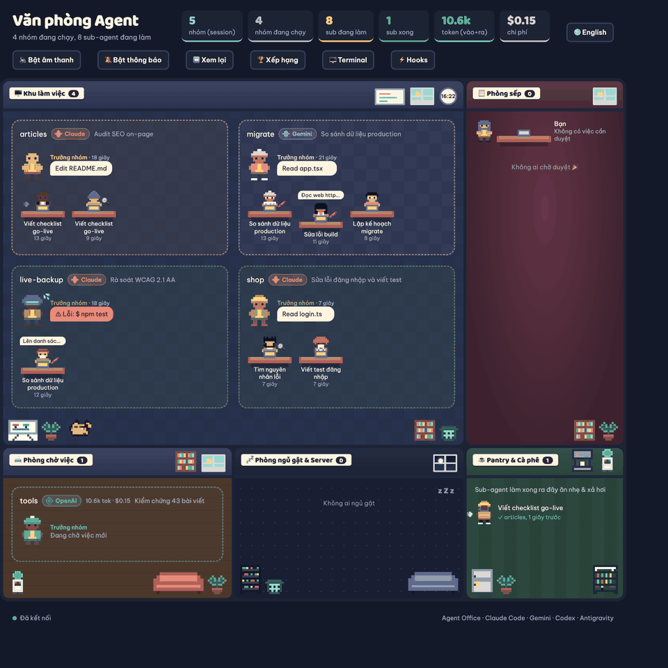
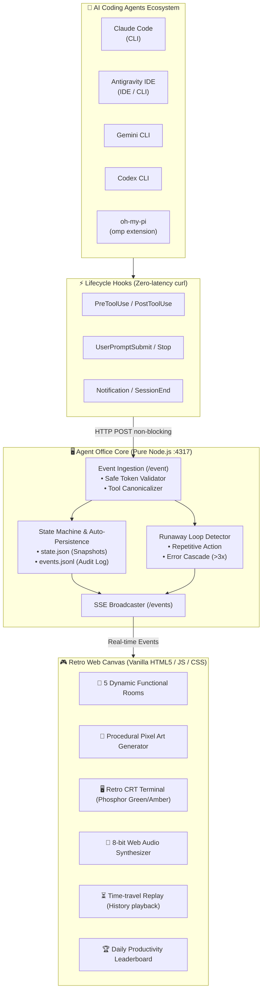

# 🏢 AGENT OFFICE

<p align="right">
  <a href="README.md">🇻🇳 Tiếng Việt</a> | <b>🇺🇸 English</b>
</p>

> **Transform dry AI command lines into a vibrant real-time Pixel Art world!**  
> Visualize **Claude Code**, **Antigravity IDE**, **Gemini CLI**, **Codex CLI**, and **oh-my-pi (omp)** along with their sub-agents inside a retro 8-bit office building.

[-success?style=for-the-badge&logo=node.js&color=68a063)](https://nodejs.org/)
[](https://github.com/giangbh/agent-office)
[](https://developer.mozilla.org/en-US/docs/Web/API/Server-sent_events)
[](https://github.com/giangbh/agent-office)
[](https://github.com/giangbh/agent-office)
[](LICENSE)

---



---

## 🌟 Why Do You Need "Agent Office"?

When working with modern Coding Agents (especially when they spawn multiple **Sub-agents** running in parallel background processes), you are often left staring at a **command-line black box**:
- ❓ *What is the agent currently doing? Reading files, running tests, or hung?*
- ❓ *How many sub-agents are working silently in the background? When will they finish?*
- 🚨 *Has your agent fallen into a **Runaway Infinite Loop**, silently draining your token wallet?*
- ❓ *When is the agent waiting for your approval (Human-in-the-loop)?*

**Agent Office** solves all of this through **Visual Gamification**:
Each active session is a **work team**, each sub-agent is an **employee typing away at their desk**, pending approvals make them **line up at the Boss Office waving for review**, finished workers chill in the **Coffee Pantry**, errors trigger **worried sweat drops 💦**, and runaway loops set off a **blaring red 8-bit siren 🚨**!

---

## ⚡ Quickstart in 30 Seconds

### 1. Instant Demo Mode (No CLI installation required)
```bash
node server.js --demo
```
👉 Open your browser at **[http://localhost:4317](http://localhost:4317)** to watch simulated pixel art teams in action immediately!

---

### 2. Connect Real Agents via 1-Click Hooks ⚡

No tedious JSON copying! Automatically install lifecycle hooks across all your tools:

#### 🖱️ Method 1: Web Dashboard Button (Easiest)
1. Start the server:
   ```bash
   node server.js
   ```
2. Open **[http://localhost:4317](http://localhost:4317)** and click the **`⚡ Hooks`** button in the top header.
3. Click **`⚡ Install All`** — the system automatically discovers and enables hooks for all tools detected on your machine!

#### 💻 Method 2: Command Line CLI (`setup-hooks.js`)
Zero external dependencies, safe with automatic `.bak` backups:
```bash
# Check current hook status
node setup-hooks.js --status

# 1-Click install across all tools
node setup-hooks.js

# Or install for a specific tool:
node setup-hooks.js --claude        # Claude Code (~/.claude/settings.json)
node setup-hooks.js --antigravity   # Antigravity IDE (~/.gemini/config/hooks.json)
node setup-hooks.js --gemini        # Gemini CLI (~/.gemini/settings.json)
node setup-hooks.js --codex         # Codex CLI (~/.codex/hooks.json)

# Clean uninstall anytime:
node setup-hooks.js --uninstall
```

> **🛡️ Safety Guarantees:**
> - Always creates `<file>.bak-agent-office` before touching any configuration.
> - Only adds/removes commands tagged with `# agent-office`, preserving 100% of your personal custom hooks.
> - CSRF / DNS Rebinding protection: Web hook management endpoints strictly require requests originating from `localhost` / `127.0.0.1`.

---

## 🏗️ Real-Time Architecture

The entire ecosystem operates with a **Zero-latency** and **Zero-overhead** philosophy:



---

## 🎯 10 Standout Features You'll Love

| Icon | Feature | Detailed Description |
|:---:|:---|:---|
| 🏢 | **5 Dynamic Functional Rooms** | Teams smoothly transition across rooms based on live state: **Work Area** (running tasks), **Boss Office** (awaiting approval), **Idle Lounge** (idle teams), **Nap & Server Room** (stale sessions), and **Coffee Pantry** (finished sub-agents). |
| 🚨 | **Runaway Loop Alarm** | When an agent is caught in an infinite loop (invoking the same tool or cascading errors $\ge 3\times$), its pod flashes red, raises the `🚨 RUNAWAY` badge, and sounds an 8-bit emergency alarm to save your wallet! |
| 🖥️ | **Retro CRT Terminal Inspector** | Press **`T`** to toggle an authentic 80s/90s CRT screen (scanlines & bulb curvature). Inspect command text, timestamps, exit codes, and stdout/stderr outputs. Supports **Phosphor Green (P1)** and **Amber (P3)** display modes. |
| ⚡ | **1-Click Hook Manager** | Manage lifecycle hooks right from the Web drawer or via the standalone CLI `setup-hooks.js`. Supports Claude Code, Antigravity IDE, Gemini CLI, and Codex CLI with automatic backups. |
| 🎨 | **Procedural Pixel Art Avatars** | Characters feature **13 hairstyles/hats** (hard hat 👷, wizard hat 🧙‍♂️, afro, cap...), **9 facial accessories** (Cyberpunk VR goggles 🥽, nerd glasses 🤓, face mask 😷, beard 🧔...), and **9 shirts** (Hawaiian 🌺, business suit 👔, hoodie...). Animated props tailored to role: 🔍 `scout`, 🖍️ `reviewer`, 💨 `sonic`, 🔨 `builder`, 🪲 `debugger`, 📜 `writer`, 🛡️ `security`. |
| 🏷️ | **Official Brand Pixel Art Logos** | Pod flags display **official pixel art emblems** for each AI engine: Claude (Anthropic 8-point sunburst), Gemini (DeepMind 4-point blue-violet star), OpenAI (teal vortex rosette), Antigravity, Codex, and omp. |
| 🛋️ | **Animated Office Furniture** | Rich pixel art props: **Water Cooler**, **Pantry Refrigerator**, **Vending Machine**, **Server Rack** with blinking LED lights, **Project Whiteboard**, **Recycle Bin**, espresso maker, sofas, and potted plants. |
| 🎵 | **8-Bit Web Audio Synthesizer** | Pure Web Audio API synthesis (zero audio files to download): crisp 8-bit coin sound on sub-agent completion, gentle bass tone on pending approvals, chirp on new task hire, and emergency sirens. |
| ⏳ | **Time-Travel History Replay** | The **⏪ Replay** control bar lets you step back in time from minutes to 24 hours. Watch your office activity replay frame by frame like a documentary. |
| 🏆 | **Productivity Leaderboard** | Click **🏆 Leaderboard** to honor the longest-running sub-agents, busiest task runners, and heaviest token consumers of the day. |
| 🌐 | **Bilingual Multi-Language Support** | Instant toggle between **English** and **Vietnamese** with the header button. Remembers your language preference across browser sessions. |
| 🛡️ | **Zero External Dependencies** | 100% built with standard Node.js and Vanilla Web APIs. Boots in under 10ms, consumes $<30\text{MB}$ RAM, and has zero third-party supply chain risks. |

---

## 🗺️ Office Layout & Mappings

```
+-----------------------------------------------------------------------------------+
|                                   AGENT OFFICE                                    |
+--------------------------+----------------------------+---------------------------+
| 🖥️ WORK AREA             | 📋 BOSS OFFICE             | ☕ PANTRY & CAFE          |
| Whiteboard, desks,       | Big wooden desk, boss      | Refrigerator, water cooler|
| bookshelf, recycling bin | waves when approval needed | snack vending machine     |
+--------------------------+----------------------------+---------------------------+
| 🛋️ IDLE LOUNGE           | 💤 NAP ROOM & SERVER RACK  | 🕒 CLOCK & SKY WINDOW     |
| Sofas, cooler, teams     | Server rack with blinking  | Automatically transitions |
| waiting for assignments  | LEDs as bash commands run  | day/night by system clock |
+--------------------------+----------------------------+---------------------------+
```

### Hook Event ➔ Office Behavior Mapping
| Hook Event | Web UI Behavior |
|:---|:---|
| `SessionStart` | New team appears in **Idle Lounge** (team name = workspace project) |
| `UserPromptSubmit` | Team flag shows instruction, team walks to **Work Area** |
| `PreToolUse` (Bash, Read, Edit…) | Activity thought bubble appears above team lead |
| `PreToolUse` (Task / Subagent) | Spawns a new desk, sub-agent walks in and types on laptop |
| `PostToolUse` (Task complete) | Sub-agent walks to **Pantry & Cafe** for refreshments |
| `Notification` (Awaiting review) | Team walks to **Boss Office** to line up; Boss waves |
| `Stop` / `SessionEnd` | Team finishes current cycle and returns to **Idle Lounge** |
| `Tool Error` | Team lead sweats 💦 with a red error alert bubble |

---

## ⌨️ Keyboard Shortcuts & Interactions

- **`T`**: Toggle Retro CRT Terminal Inspector.
- **`Esc`**: Dismiss any active drawer (Terminal, Hooks Manager, Leaderboard, or Team Inspector).
- **`Click any Pod`**: Open right-hand Inspector drawer showing latest 20 tool calls, sub-agent Gantt timeline, and token/cost metrics.
- **`Click any Tool line`**: Jump directly to that command in the Retro CRT Terminal.
- **`Click Office Mascot 🐾`**: When the workspace is empty, a mascot companion patrols the floor: **Butler Cat 🐱**, **Pikachu ⚡**, **Eevee 🦊**, or adorable chunky **Snorlax 💤** (rendered in crisp $52 \times 52$ pixels). Click the mascot to hear custom 8-bit sound effects (Meow / Pika / Eevui / soothing Poké Flute lullaby) and **cycle between Cat and Pokémon companions**! While agents are working, the mascot curls up peacefully in the corner.
- **`🌐 Language Button`**: Switch UI language between **English** and **Tiếng Việt**.
- **`Tab` + `Enter` / `Space`**: Full keyboard accessibility support.

---

## 📊 Platform Compatibility Matrix

| Platform | Support Status | Setup Command | Highlights |
|:---|:---:|:---|:---|
| **Claude Code** | 🟢 Complete | `setup-hooks.js --claude` | Real-time token usage parsed from `.jsonl` transcripts, sub-agent detection |
| **Antigravity IDE** | 🟢 Complete | `setup-hooks.js --antigravity` | Native support for `PreInvocation`, `PreToolUse`, `invoke_subagent` |
| **Gemini CLI** | 🟢 Complete | `setup-hooks.js --gemini` | Automatic canonicalization of tool names (`run_shell_command` ➔ Bash) |
| **Codex CLI** | 🟢 Complete | `setup-hooks.js --codex` | JSON lifecycle hooks format compatible with Claude standards |
| **oh-my-pi (omp)** | 🟢 Complete | `omp-office.ts` extension | Real USD cost tracking, background sub-agent monitoring |

---

## ⚙️ Advanced Environment Variables

Customize server settings using standard environment variables:

```bash
# Change port and expose to local area network (LAN):
HOST=0.0.0.0 PORT=5000 node server.js

# Enable Secret Token authentication (requires X-Agent-Office-Token header):
AGENT_OFFICE_TOKEN=my-secret-token node server.js

# Tune stale session and abandonment timeouts:
STALE_MIN=10 ABANDON_MIN=30 node server.js

# Custom storage directory for state.json and events.jsonl:
AGENT_OFFICE_DATA=/var/log/agent-office node server.js
```

---

## 🎨 For Developers: Hacking & Extensibility

Agent Office is crafted without any bundlers or heavy build steps. You can directly edit `index.html` to customize:

- **Add custom character styles**: Expand the `HEADS`, `FACES`, or `SHIRTS` arrays — each character in the string represents a pixel color!
- **Add custom furniture**: Add new sprites to the `FURN` object in ASCII art format.
- **Hook your custom bots**: Fire a standard HTTP POST request from any language:
  ```bash
  curl -X POST http://localhost:4317/event \
    -H "Content-Type: application/json" \
    -d '{
      "event": "PreToolUse",
      "session_id": "my-custom-bot",
      "agent_source": "custom",
      "tool_name": "Bash",
      "tool_input": { "command": "npm test" }
    }'
  ```

---

## 📄 License

Distributed under the open-source **MIT License**. Free to use, modify, and share with the AI engineering community.

<div align="center">
  <sub>Built with love for Pixel Art and the Multi-Agent Coding Era.</sub><br>
  <b>Agent Office — Bringing joy back to thousand-line coding sessions! ☕🚀</b>
</div>
