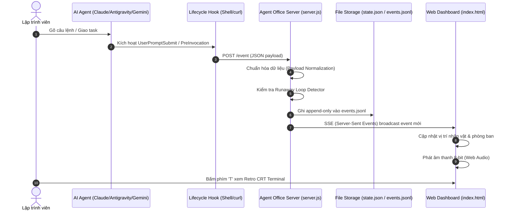
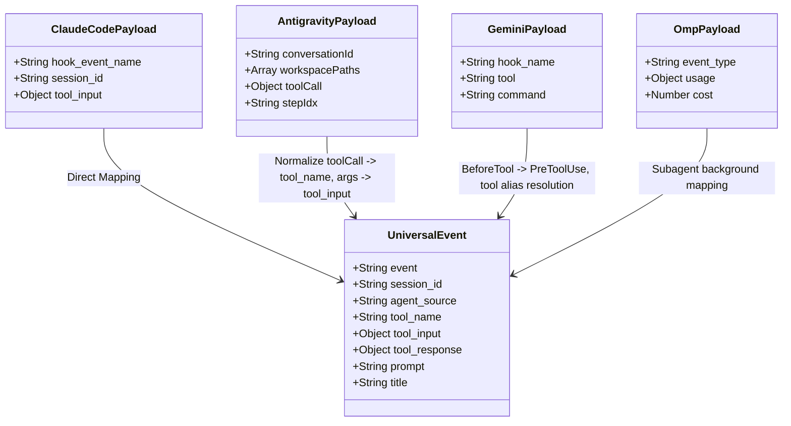

# 🏛️ Agent Office Architecture & Technical Specification

Tài liệu thiết kế kiến trúc kỹ thuật nội bộ của **Văn phòng Agent (Agent Office)**. Dành cho các kỹ sư, nhà phát triển muốn đóng góp hoặc mở rộng hệ sinh thái đa tác nhân (Multi-Agent Ecosystem).

---

## 1. Triết lý thiết kế cốt lõi (Core Philosophy)

1. **Zero External Dependencies**:
   - Backend thuần **Node.js Core Modules** (`http`, `fs`, `path`, `os`, `url`, `events`).
   - Frontend thuần **Vanilla HTML5 Canvas, Modern CSS và Web Audio API**. Không React, không Vue, không Webpack, không Tailwind.
   - Khởi động tức thì (< 15ms), chiếm dụng bộ nhớ cực thấp (< 30MB RAM).

2. **Non-Blocking & Zero Overhead cho Agent**:
   - Các hook từ phía Agent CLI/IDE chạy `curl` với `--max-time 1` và cờ thoát lỗi `|| true`.
   - Nếu server Agent Office tắt hoặc gặp sự cố, luồng công việc của Agent chính **không bao giờ bị gián đoạn hay chậm trễ**.

3. **Deterministic Spatial State Machine (Máy trạng thái không gian)**:
   - Mọi hoạt động của agent được mô hình hóa thành tọa độ và phòng ban trong một tòa nhà.
   - Trạng thái hệ thống được snapshot định kỳ vào `state.json` và lưu dấu vết kiểm toán (audit log) vào `events.jsonl`.

---

## 2. Luồng dữ liệu tổng thể (Data Pipeline)



---

## 3. Bộ chuẩn hóa Payload (Universal Protocol Adapter)

Các CLI/IDE khác nhau gửi cấu trúc sự kiện hoàn toàn khác nhau. `server.js` đóng vai trò là một **Universal Adapter**:



### Bảng chuẩn hóa tên Tool (Tool Canonicalization)
Để hiển thị thống nhất trên giao diện:
- `run_shell_command`, `CommandLine`, `execute_command` ➔ **`Bash`**
- `read_file`, `view_file`, `cat` ➔ **`Read`**
- `replace_file_content`, `write_to_file`, `edit_file` ➔ **`Edit`**
- `grep_search`, `find_files`, `glob` ➔ **`Glob` / `Grep`**
- `invoke_subagent`, `task`, `Task` ➔ **`Task`** (Kích hoạt sub-agent ngồi vào bàn)

---

## 4. Thuật toán phát hiện Vòng lặp Vô tận (Runaway Loop Detection)

Vấn đề nghiêm trọng nhất của Multi-agent tự động là rơi vào vòng lặp vô tận (đọc lại file lỗi, chạy lại cùng một lệnh bash không thoát được), gây lãng phí hàng triệu token.

Agent Office tích hợp bộ phát hiện **Sliding-Window Pattern**:

```javascript
// Thuật toán phát hiện lặp lại:
// 1. Duy trì bộ nhớ trượt 5 hành động gần nhất của từng session
const recent = session.recentActions.slice(-5);

// 2. Kiểm tra điều kiện lỗi liên hoàn (Error Cascade):
const consecutiveErrors = session.consecutiveErrors >= 3;

// 3. Kiểm tra điều kiện lặp lại câu lệnh (Command Repetition):
const isLooping = recent.length >= 3 && recent.every(a => 
    a.tool === currentTool && a.signature === currentSignature
);

if (isLooping || consecutiveErrors) {
    session.runawayAlert = true;
    broadcast({ type: "RUNAWAY_LOOP_ALERT", sessionId: session.id });
}
```

Khi được kích hoạt:
1. Giao diện frontend đổi viền bàn làm việc của nhóm thành **viền đỏ nhấp nháy 2Hz**.
2. Giương còi báo động **`🚨 VÒNG LẶP`**.
3. Kích hoạt bộ tạo dao động (Audio Oscillator) phát sóng âm **Còi báo động đa tần 8-bit**.

---

## 5. Kiến trúc Đồ họa Pixel Art & Âm thanh 8-Bit Thuần

### A. Procedural Pixel Compositing
Tất cả nhân vật không tải bất kỳ file ảnh ngoài nào:
- Mỗi sprite là một ma trận ký tự $8 \times 8$ hoặc $12 \times 12$.
- Mã màu định nghĩa bằng ký tự:
  ```
  . = Trong suốt
  K = Đen viền
  S = Da người (Skin tone)
  H = Tóc nâu / vàng / đen
  Y = Cà vạt vàng của Trưởng nhóm
  C = Màu áo theo mã băm nhóm (Session Hash Color)
  ```
- Ghép tầng: `Background ➔ Furniture ➔ Body ➔ Shirt ➔ Face/Head ➔ Accessories (🔍, 🖍️, 💨) ➔ Bubble Overlay`.

### B. Bộ tổng hợp âm thanh Web Audio Chiptune
Không sử dụng file `.mp3` / `.wav`. Sử dụng trực tiếp `AudioContext` để tổng hợp sóng âm dạng cổ điển:
- **Ting nhặt xu (Coin Pickup)**: Sóng vuông (`square`) tăng vọt tần số từ `987.77Hz (B5)` lên `1318.51Hz (E6)` trong `0.15s`.
- **Còi báo động (Siren)**: Bộ dao động tần số thấp (LFO) quét tần số từ `440Hz` đến `880Hz` theo chu kỳ tam giác (`triangle`).
- **Phê duyệt của sếp**: Hợp âm trầm hai nốt kết hợp bộ lọc thông thấp (Low-pass filter).

---

## 6. Tua ngược thời gian (Time-Travel Replay Engine)

Tất cả các sự kiện được ghi nhận theo định dạng Append-only JSON Lines tại `events.jsonl`:
```json
{"ts": 1791963000000, "event": "PreToolUse", "session_id": "proj-a", "tool": "Bash", "input": "git status"}
{"ts": 1791963005000, "event": "PostToolUse", "session_id": "proj-a", "tool": "Bash", "exit_code": 0}
```

Khi người dùng mở **⏪ Xem lại**:
1. Server đọc $N$ dòng sự kiện trong phạm vi $M$ phút yêu cầu (`GET /replay?minutes=60`).
2. Client nhận toàn bộ luồng sự kiện và chạy một **State Accumulator**:
   $$\text{State}_t = \sum_{i=0}^{t} \Delta \text{Event}_i$$
3. Thanh trượt thời gian cho phép người dùng kéo đến bất kỳ mốc thời gian nào trong quá khứ để xem văn phòng tại đúng khoảnh khắc đó.

---

## 7. Đóng góp & Phát triển mở rộng

Mọi đóng góp cho dự án đều tuân thủ các quy chuẩn sau:
- Giữ vững quy tắc **Zero npm runtime dependencies**.
- Bất kỳ API mới nào cũng phải hỗ trợ fallback cho các môi trường terminal cũ.
- Tương thích đa nền tảng: macOS, Linux, Windows (WSL/Git Bash).
